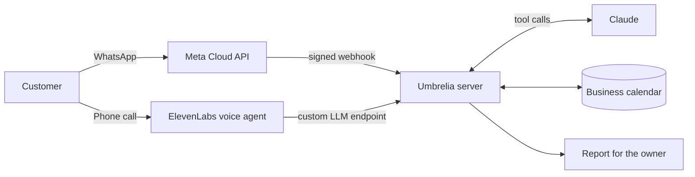

# Umbrelia · AI receptionist for WhatsApp and phone

An assistant that answers customers of appointment-based businesses (beauty salons, dental clinics),
gives prices from the business's own data, and **books, moves and cancels appointments** in its calendar,
on WhatsApp and over the phone.

## Try it now

### [▶ Talk to the receptionist by voice](https://josemdasilvag-blip.github.io/umbrelia/)
A call in your browser, no phone needed. She speaks English and Spanish; the page has phrases to try.

### [💬 Message it on WhatsApp: +34 644 402 947](https://wa.me/34644402947?text=Hi!)
Write in English or Spanish. Ask what a teeth whitening costs, book an appointment for Thursday afternoon,
then move it or cancel it.

Both answer for a demo business: a fictional beauty and dental clinic in Madrid.

The public demo lets you test the customer experience: ask for a price or an
available slot, book a test appointment, then move or cancel it. It uses a demo
calendar, not a real clinic's appointments. Voice access requires microphone
permission in your browser; WhatsApp opens a conversation with the demo number.

[Watch the explainer video](https://umbrelia.es/video/umbrelia-explicativo.mp4) · [umbrelia.es](https://umbrelia.es)

## What it does

- Answers questions with the business's own price list, team, opening hours, holidays and rules.
  If something is not in that data, it says so instead of making it up.
- Finds free slots and books, moves and cancels appointments. Two customers can never take the same slot.
- Hands the conversation to a person when it cannot help, and never confirms an appointment it did not save.
- Answers phone calls with the same brain, through a voice agent.
- Builds a report for the owner of what it handled: conversations, bookings and hand-offs.

## How it works

One server serves every business. Each business is a data file with its services, prices, durations,
team and rules, so adding a new client means filling in a file, not writing code.

## Built to be reliable

| | |
|---|---|
| **67 internal automated tests** | Booking, rescheduling, cancelling, voice, reports and the server. Results and source are in the private product repository, so they cannot be inspected from this public showcase. |
| **Slot locking** | Concurrent requests cannot double-book the same slot. |
| **Strict scope** | It only talks about the business, as Meta requires for WhatsApp assistants since January 2026. |
| **Always on** | Runs as system services on a dedicated cloud server behind a Cloudflare tunnel. |

**Stack:** Python · Claude API (tool use) · Meta WhatsApp Cloud API · ElevenLabs Agents (custom LLM) ·
Google Calendar · Cloudflare · Linux / systemd

## Source code

The code is private because it is the product of the agency.
Access for review can be granted on request.

This public repository documents the product and hosts the voice demo page. It
does not contain the assistant's backend or its test suite. The demo shows what
a visitor can try; it is not a public verification of the internal test count,
deployment setup or concurrency safeguards.

---

Built by **Jose Manuel Da Silva** · [umbrelia.es](https://umbrelia.es)
